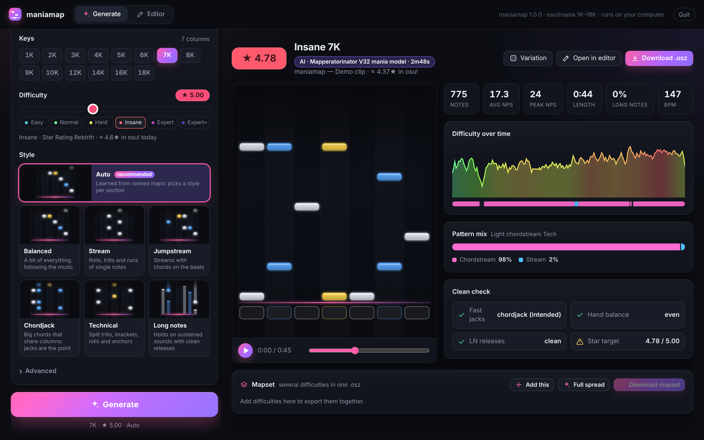

# maniamap

**Turn any song into an osu!mania map, at the difficulty you choose.** Drop in a song, pick the key count (1K–18K) and the stars, and maniamap maps it with an AI trained on ranked maps. Preview it, adjust it in the built-in editor, and export a ready-to-play `.osz` mapset. Everything runs on your own computer.



## What you get

- **AI mapping.** The default engine is Mapperatorinator, an osu!mania model trained on ranked maps, tuned per key count (7K uses the setup that came closest to ranked 6–10★ maps). An instant *Quick rules* engine makes drafts, and the optional MuG Diffusion engine does 4K.
- **Difficulty first.** Set the stars before generating; the result lands on target (Star Rating Rebirth, up to about 11★ osu!). A full spread (Easy → your target) exports as one mapset.
- **On beat.** Tempo, offset and tempo changes are detected from the audio and checked against ranked maps; notes sit where mappers put them.
- **See what you got.** A falling-notes preview synced to the music, a difficulty graph, the pattern mix (streams, jumpstream, chordjack, LN…) and a clean check (no accidental fast jacks or overlaps).
- **Edit.** A full editor for any key count: timing, long notes, live mapping, pattern lanes, clean key conversion and LN conversion.
- **Private.** No account and no upload: the app and the AI run locally.

## Install (Debian / Ubuntu)

1. Install the requirements:

   ```bash
   sudo apt install nodejs npm ffmpeg git
   ```

2. Download maniamap and install it. Either take the latest release package from the [Releases page](https://github.com/WaterLily5297/mapping/releases) and run:

   ```bash
   tar -xzf maniamap-*-linux.tar.gz && cd maniamap-*/ && ./install.sh
   ```

   or get the source with git (builds it, a few minutes):

   ```bash
   git clone https://github.com/WaterLily5297/mapping.git maniamap && cd maniamap && ./install.sh
   ```

3. Open **maniamap** from your applications menu (or run `maniamap editor`). The first time, click **Set up the AI** on the Generate screen. It downloads the AI model once (about 2 GB, 10–30 minutes) and needs no terminal. Without it, maps come from the Quick rules engine, which is much lower quality.

Node.js 20 or newer is needed; Debian 13 ships it. `maniamap doctor` checks everything and tells you how to fix whatever is missing.

## Make a map

1. **Song.** Drop an `.mp3` / `.ogg` (or an `.osz`, which keeps its own timing). maniamap detects the tempo; use **×2 / ÷2** if it feels half or double.
2. **Keys and stars.** Pick the key count and drag the star slider to the difficulty you want.
3. **Generate.** The AI takes a few minutes per minute of song on a CPU (much less with an NVIDIA GPU); Quick rules takes a second. Press Space to preview.
4. **Export.** *Download mapset* gives an `.osz`; drag it onto osu! to play. *Full spread* adds easier difficulties, *Variation* makes another version, and *Open in editor* lets you fix things by hand.

Please say that a map was AI-generated when you share it.

## Command line

```bash
maniamap automap song.mp3 --keys 7 --stars 8 -o song.7k.osz   # AI when set up, else Quick rules
maniamap adjust map.osu --stars 6                              # make a map easier or harder, cleanly
maniamap convert map.osu --keys 7                              # clean key conversion
maniamap sr map.osu                                            # star rating and difficulty graph
maniamap doctor                                                # check the installation
maniamap update                                                # update maniamap
maniamap help                                                  # everything else
```

## Troubleshooting

| Problem | What to do |
|---|---|
| `maniamap: command not found` | Open a new terminal (or log out and in), or run `~/.local/bin/maniamap`. |
| The AI setup stops | Run `maniamap doctor`; it names what is missing (usually `git` or `ffmpeg`: `sudo apt install git ffmpeg`). Then click **Set up the AI** again, or run `maniamap setup ai`. |
| AI charts differ a lot from run to run | Set *Best of* to 2 or 3 under the AI settings: the AI runs that many times and the best chart is kept (most useful in 4K). It takes that many times longer. |
| AI maps take long | Normal on a CPU: a few minutes per minute of song. Pick *V32-mini* under the AI settings for about twice the speed, or use an NVIDIA GPU. |
| The beat feels off | Check the BPM on the Generate screen (×2 / ÷2), or drop the song's `.osz` to reuse its timing. |
| Nothing opens from the menu | The log is in `~/.local/state/maniamap/app.log`; `maniamap editor` in a terminal shows errors directly. |

To uninstall: `./install.sh --uninstall` in the maniamap folder, then delete the folder and `~/.local/share/maniamap` (the AI and its model).

## More

- [Technical guide](docs/technical.md): how the engines, audio analysis and models work, with the measurements behind every default, plus LoRA style training and all command-line tools.
- [Changelog](CHANGELOG.md)
- Licence: MIT ([LICENSE](LICENSE)). The AI engines are separate projects with their own licences ([THIRD_PARTY_NOTICES.md](THIRD_PARTY_NOTICES.md)); MuG Diffusion's weights and the charts it makes are non-commercial. osu! is a trademark of ppy Pty Ltd; maniamap is not affiliated with it.
