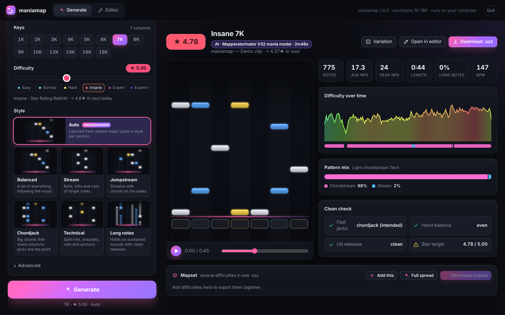
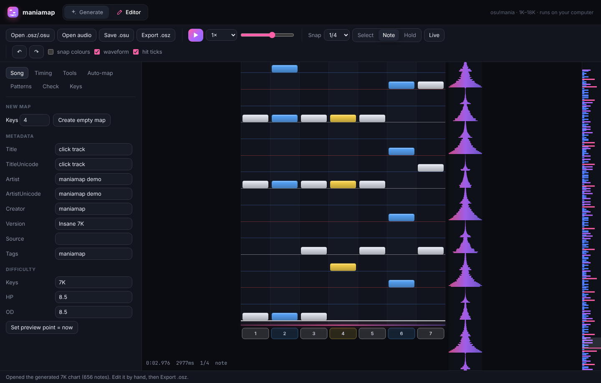

# maniamap — technical guide

How maniamap works inside, with the measurements behind every default: engines, audio analysis, models, benchmarks and all command-line tools. For installing and using it, see the [README](../README.md).

An osu!mania map generator and editor for **any key count (1K–18K)**. Drop a song, pick the keys, set the star rating **before** generating, choose a style, and get a clean, playable chart in seconds. Preview it, export a whole mapset as `.osz`, or polish it in the built-in editor.



| Part | What it does |
|---|---|
| **Generate** (browser) | Song → keys, target ★, style → chart. Tempo detection with ×2/÷2, six styles with live pattern previews, star slider in osu!'s difficulty colours, falling-notes preview synced to the music, difficulty-over-time graph, pattern mix and clean check, variations, **full difficulty spreads** (Easy → your target) exported as one mapset `.osz`. Built-in engine or the Mapperatorinator AI |
| **Editor** (browser) | Vertical-scroll chart editor with audio playback, snap grid (1/1–1/16), notes and long notes, select/move/copy/paste, mirror, undo/redo, waveform, density overview, hit ticks, playback rate, live mapping with the keyboard, timing points (BPM/SV), tap BPM, open/export `.osu` and `.osz` |
| **Toolkit** | Clean key conversion N→M (1K–18K) and a clean LN converter (light / hybrid / full / inverse), each with a "dirt" check. Also mirror, shuffle columns, randomize, full LN, inverse LN, LN→rice, quantize, remove overlaps, rate change, stats and problem check (unsnapped notes, overlaps, stacked notes) |
| **Difficulty** | Star rating for any key count with **Star Rating Rebirth** (the 2025 "Sunny" rework), plus an estimate of the current in-game osu! value. You **set the target ★ before generating**: the auto-mapper searches its settings until the chart lands there, and `adjust` brings any map (also AI output) to a target ★ by cleanly removing or adding notes |
| **Pattern classifier** | Labels every part of a chart: stream, jumpstream, handstream, chordstream, jack, chordjack, trill, jumptrill, split trill, roll, inverse, hold + tap, LN, slow. Gives sections with speed (`1/4 @ 180`), NPS, anchors and minijacks, plus the share of the map's time and of its notes per pattern and per skillset. In the editor: a coloured lane next to the playfield, a Patterns tab, and "select all notes of a pattern" so the tools can act on, for example, only the jumptrills |
| **Auto-mapper** | Audio → onsets (spectral flux) → BPM and offset → beat-grid snap → density filter → chords → **pattern engine** → LNs. Styles: balanced, stream, jumpstream, chordjack, technical, long notes. Five difficulty presets plus sliders, or a **target star rating**. It can fill a time range only, so you can generate a section and then edit it by hand |



Everything runs locally. The browser app needs no server and does not upload any data.

## Install on Debian 13 (trixie)

```bash
sudo apt install git nodejs npm ffmpeg
```

```bash
git clone https://github.com/WaterLily5297/mapping.git maniamap && cd maniamap && ./install.sh
```

To update later, run `git pull && ./install.sh` in the same folder. (A source tarball works too: `tar xzf maniamap-src.tar.gz && cd maniamap && ./install.sh`.)

`install.sh` installs the dependencies, builds, runs the tests, and adds:

- the `maniamap` command (`~/.local/bin`)
- a **maniamap** entry in your applications menu

Root is only needed for `apt`, and `./install.sh --uninstall` removes both. Debian 13 ships Node 20, which is enough. ffmpeg is only needed by the CLI auto-mapper and by `rate`.

### Editor

```bash
maniamap editor
```

This starts a small local server (127.0.0.1 only) and opens maniamap in your browser, on the **Generate** screen. Press Ctrl+C in the terminal to stop it. The editor is a web page, but nothing leaves your computer. Browsers refuse to run it from a `file://` URL, which is why it needs the small server.

**Engines.** maniamap generates with one of three engines, and every result says which one made it:

| Engine | What it is | Quality | Speed (CPU) |
|---|---|---|---|
| **AI model** (default when installed) | Mapperatorinator V32, the osu!mania transformer trained on ranked maps (`OliBomby/Mapperatorinator-v32`, `gamemode=3` weights), conditioned on keys, stars, hold-note ratio, style tags and a **reference mapper** | the real thing | a few minutes per minute of song |
| **MuG Diffusion** (4K only, optional) | latent-diffusion charting model by Keytoyze, steered by stars, style (stream / jumpstream / chordjack / technical) and LN amount. **Weights and generated charts are non-commercial** | AI | a few minutes per 40 s of song (50 steps, CPU) |
| **Quick rules** | onset detection + the pattern engine and small learned models described below | draft quality | about a second |

Install the AI model once with `scripts/setup-mapperatorinator.sh` (see *AI mapper* below). Without it the app falls back to quick rules and says so on screen.

MuG Diffusion is optional: `scripts/setup-mug-diffusion.sh` clones it, creates its Python environment and fetches its weights. They only ship inside a 4.4 GB Windows bundle on Google Drive; the script reads the bundle's zip directory over HTTP range requests and downloads just `model.ckpt` (1.8 GB) and `model.yaml` (or pass `--zip` for a bundle you already have). maniamap runs it headless (`scripts/mug/mug_generate.py`, the same pipeline as MuG's web UI, without gradio), snaps to the detected or given timing, keeps MuG's `AIMode` tag and adds `mug-diffusion` to the tags. Then: `maniamap mug song.mp3 --stars 4 --style jumpstream`, `automap --engine mug`, or *AI · MuG Diffusion (4K)* on the Generate screen (the button appears when it is installed).

**Reference mapper.** The mania model was trained with a mapper token, so it can map in the style of mappers it knows. maniamap keeps a catalog of 356 such mania mappers with the key counts and star ranges of their ranked/loved maps (`src/ai/mappers.json`, built by `scripts/bench/build-mapper-catalog.ts` from the model's own tokenizer). *Style reference → Auto* picks the mapper with the most ranked maps at your key count and star rating; you can also choose one. On the command line: `maniamap ai-mappers --keys 4 --stars 7` lists them, `--mapper auto|NAME|ID` uses one. On 6 held-out 4K songs (30-second sections, the song's own mappers excluded) the reference mapper brought the AI's pattern mix closer to the ranked maps (skill-mix distance 0.50 → 0.40) at about the same rhythm accuracy (F1 0.90 → 0.89). The model maps easier than asked when it has a reference mapper, so maniamap raises its difficulty input by 0.3★, and the star adjustment does the rest. Caveat: the model was trained on ranked maps up to 2024 and may know some test songs, which flatters every AI number on ranked songs.

**Generate:** drop a song (or an `.osz`), check the detected BPM, pick keys, stars and style, and press Generate. An `.osz` brings its own timing: every red line is kept, so songs with tempo changes map on their real beat grid. Space plays the preview. *Variation* makes another chart with the same settings, *Full spread* adds easier difficulties to the mapset, and *Download mapset* gives one `.osz` with all of them. *Open in editor* continues by hand.

**Editor:** open a `.osz` (or a `.osu` plus its audio). Detect or tap the BPM on the **Timing** tab. Map by hand, live-map with Tab, or **Auto-map** a section. Check **Patterns** and **Check**. Then Export `.osz` and import it into osu!.

### CLI

```bash
maniamap help
```

```bash
maniamap automap song.mp3 --keys 7 --stars 4.5 -o song.7k.osz          # AI model when installed (reference mapper: auto)
maniamap automap song.mp3 --keys 7 --stars 4.5 --engine rules          # instant rule-based draft
maniamap automap song.mp3 --keys 7 --difficulty hard -o song.7k.osz    # or use a preset
maniamap patterns map.osu                                                # pattern sections, category, suggested osu! tags
maniamap sr map.osu                                                      # star rating + difficulty graph
maniamap adjust map.osu --stars 3                                        # make a map easier/harder, cleanly
maniamap convert map.osu --keys 10                                       # 4K -> 10K, etc. (clean)
maniamap ln map.osu --preset hybrid                                      # rice -> LN (clean)
maniamap info map.osu                                                    # stats + star rating + problems
maniamap fullln map.osu --gap 0.25
maniamap shuffle map.osu --mode random --seed 42
maniamap rate map.osu --rate 1.2                                         # chart + audio via ffmpeg
maniamap automap song.mp3 --keys 4 --stars 3 --timing map.osu           # use a map's timing (tempo changes)
```

### The pattern engine and styles

Generated charts are built in patterns, the way mappers think, not note by note. Every beat gets a pattern family that fits its rhythm: rolls, trills and streams for fast single notes; jumpstream, jumptrills, split trills, brackets, chord rolls or chordjacks for fast chords; anchors and pitch-following chords for slower parts. A family usually carries on into the next beat, a rhythm that comes back within 8 beats usually gets the same (or mirrored) shape, chords are split over both hands, and there are no fast jacks (¼ beat or 90 ms apart) unless the style is about jacks.

| Style | What you get |
|---|---|
| **Auto** (default) | A learned model picks the style for every measure from the music and the star target (see below) |
| Balanced | A bit of everything, following the music |
| Stream | Rolls, trills and runs of single notes, few chords |
| Jumpstream | Streams with chords on the beats and half beats |
| Chordjack | Big chords that share columns: the jacks are intentional |
| Technical | Split trills, brackets, chord rolls and anchors |
| Long notes | Holds on sustained sounds with clean releases (hybrid LN) |

`automap song.mp3 --keys 7 --stars 4 --style jumpstream`, or the Style cards on the Generate screen.

**Auto style.** Mappers choose patterns from the music: streams where the hats run, jumpstream over driving beats, chordjack for heavy hits at high difficulty. `src/automap/stylemodel.ts` is a small model (multinomial logistic regression over 16 per-measure features: onset density and strength, loudness, sustain, low/mid/high band energy, pitch, tempo, key count and the star target) trained by `scripts/bench/train-style-model.ts` on 40,000 measures of ranked 4K–10K maps, labelled with the pattern classifier. It picks a style for every measure, smoothed over neighbouring measures so sections stay coherent; when a high target cannot be reached cleanly, loud sections lean towards chordjack.

**Learned rhythm.** Where notes go matters most. `src/automap/rhythmmodel.ts` scores every tick of the beat grid with how likely a mapper is to put a note there (logistic regression over flux, band energy, onset salience, loudness, a detected onset, the tick's place in the measure, tempo and the star target), trained by `scripts/bench/train-rhythm-model.ts` on 1.25 million ticks of ranked maps (including about 390 maps of 6–11★). The generator keeps the most likely ticks, as many as the density asks for; above the densest preset, the star search takes the model's next most likely ticks. On held-out songs it picks the ranked map's ticks 84% of the time at the ranked note count, against 60% for the old "loudest onsets on strong beats" rule. The grid also adapts to the tempo: it is never finer than 60 ms (a 284 BPM song gets 1/2, not 1/4).

On songs neither model saw (every third song held out), from the balanced style with onset rhythm to auto style with learned rhythm:

| Held-out songs | Star error | Rhythm F1 | Skill-mix distance | Dirt (ranked maps) |
|---|---|---|---|---|
| 4K, 40 songs | 0.52 → **0.03**★ | 0.73 → **0.81** | 0.53 → **0.39** | 92 → 202 (185) |
| 7K, 20 songs | 0.03 → 0.04★ | 0.70 → **0.83** | 0.38 → **0.37** | 49 → **30** (48) |

The 4K dirt rise is the chordjack that the ranked maps have too (a quarter of their time); outside chordjack sections there are still no fast jacks. LN maps are left out of training: rice or LN is the mapper's choice, so the Long notes style stays yours to pick.

**High difficulty (6–12★).** The star slider goes to 12.5 (≈ 11★ in osu! today). The hardest ranked maps split into two families: dense streams / jumpstream / handstream, and chordjack. From 6★, auto style decides per song with the style model's song-wide chordjack probability (cutoff 0.39, chosen on training songs only): speed songs get *speed mode*, where intensity buys rows rather than chords (up to 4× the detected onsets, ~80% single notes like the ranked maps) and the grid adds 1/6 and 1/8 ticks (from 7.5★ down to 28 ms: 1/8 at 240 BPM). From 7.5★, speed mode may use 1/4-beat minijacks, which the hardest ranked streams contain; without them dense 1/8 runs in 4K have no free column. Below 7.5★ the charts stay jack-clean. On held-out 6★+ songs (30 4K, 27 7K) star error is 0.07–0.08★, rhythm F1 0.80 (4K) / 0.76 (7K) and skill-mix distance 0.44 / 0.31 — about the same as before these changes on average: 7–8★ 4K improved little, and 8★+ maps (rhythm F1 0.68) remain the hardest to match. The gain is in range and character: 8–11★ charts can now be speed charts instead of only chordjack. On 13 held-out 8–11★ songs (mostly 7K) star error is 0.035★, rhythm F1 0.77 and skill-mix distance 0.34.

**Benchmark.** `npx tsx scripts/bench/generator-bench.ts DATA_DIR` generates charts for songs that have ranked maps (e.g. from `data-fetch`), using the ranked map's key count, timing and star rating, and compares them: star error, rhythm F1 against the ranked rows, chord-size and skill-mix distance, dirt and pattern repetition. Against the earlier note-by-note generator, the pattern engine has 32% less dirt on 30 4K songs (134 → 91 per 1000 notes) and 40% less on 20 7K songs (106 → 64, the same as the ranked maps' 65) at the same rhythm F1 (0.75). With the style that matches each ranked map, the star error halves (0.42 → 0.20★) and the skill mix gets closer to the ranked maps (distance 0.49 → 0.38).

### Clean conversion (any keys, LN)

"Dirty" conversions are the usual complaint about converters: new fast jacks, one hand doing everything, LNs that release right before the next note. maniamap's converters measure that and avoid it. `convert` and `ln` print a **clean check** (per 1000 notes: fast jacks, jacks, hand overload, hand imbalance, short LNs, tight releases, off-grid releases, locked holds), and so does the editor's status bar.

- **Key conversion (`convert --keys M`, Tools tab):** every measure gets the cleanest *order-keeping* column mapping. A trill stays a trill and a roll stays a roll. Notes that would collide or create a fast jack are moved to the nearest clean column on the same hand. Hands are kept balanced over the whole map; the middle key of odd key counts counts for both hands. `--fill 0..1` adds chord notes when going up in keys (only on beats and half beats, never making a jack), and `--spread-jacks` breaks the source's jacks across the new columns. Tested on 371 ranked maps: 4K→7K and 7K→4K give 0 new fast jacks.
- **LN conversion (`ln`, Tools tab):** presets `light` (≈20% LN), `hybrid` (≈45%), `full` and `inverse` (≈80%), or set your own short/long ratios. Releases snap to the beat grid, keep a safe gap (≥ ¼ beat and ≥ 60 ms) before the next note in the column, holds are shortened when they would cover a fast run on the same hand, and existing LNs are kept.

### Difficulty: set the stars before generating

maniamap rates charts with **Star Rating Rebirth** by [Crz]sunnyxxy (2025), the algorithm behind the community "Sunny rework" of osu!mania star rating. It models jacks, cross-column movement, density and chords, unevenness and LN releases on a 1 ms grid, and works for every key count (the paper covers 1K–10K; 11K–18K use the same weight pattern). The implementation was written from the paper and compared with the reference program on 120 ranked maps: correlation 0.998, mean difference 0.14★. Next to it maniamap prints an estimate of the **current in-game osu! star rating** (fitted on the same maps, about ±0.3★).

- **Built-in auto-mapper:** `automap --stars X` (or **Target ★** in the editor's Auto-map tab). It picks a preset tier, moves up or down a tier if needed, bisects density, and for high targets raises intensity (more onsets, bigger chords, jumpstreams). Then it fine-tunes with `adjust`. The generator never makes fast jacks (≤ ¼ beat or 90 ms). Every song has a ceiling: a slow, calm song cannot become an 8★ 4K map cleanly, and maniamap says so instead of forcing it.
- **AI mapper:** `ai --stars X` takes the same scale, converts it to the osu! value the model was trained on, reports the star rating of the result, and with `--fit` adjusts it to the target (the editor does this by default).
- **Any map:** `adjust map.osu --stars X` (Tools → Difficulty). Going down, it removes the least important notes first: fine snaps before strong beats, chord extras before single notes, jacks and the hardest sections first, with hands kept balanced. Going up, it adds notes on beats and half beats and in 1/2–1/4 gaps, never a jack. `--allow-jacks` also allows ½-beat chord jacks when there is no other room.
- `sr map.osu` prints the rating, the osu! estimate and a graph of difficulty over time (`--rate 1.2` for rate changes, `--json` for scripts).

### AI mapper (Mapperatorinator)

maniamap can drive [Mapperatorinator](https://github.com/OliBomby/Mapperatorinator) (OliBomby, MIT), an AI trained on ranked osu! maps. It has an osu!mania model that supports 1K–18K. Install it once (about 1 GB of Python packages plus the 0.9 GB mania model):

```bash
sudo apt install git ffmpeg pipx && pipx install uv
```

```bash
scripts/setup-mapperatorinator.sh
```

```bash
maniamap ai-status
```

The setup script installs CPU-only PyTorch unless it finds an NVIDIA GPU. Pass `--cpu` to force the CPU build.

Then either:

- **Editor:** in `maniamap editor`, open **Auto-map** and pick **AI: Mapperatorinator**. Set the keys and target ★, and tick the style tags you want (osu! user tags such as `style/jumpstream`, `skillset/speedjack` or `style/LN release`). Set a range to regenerate only one section.
- **CLI:**

```bash
maniamap ai song.mp3 --keys 7 --stars 4 --tags style/jumpstream,skillset/streams -o song.7k-ai.osz
```

maniamap detects the BPM first and gives it to the model as timing, which makes generation much faster; use `--timing map.osu` for your own timing or `--ai-timing` to let the model time the song. After generation maniamap:

- removes overlapping notes
- reports the star rating of the result and, with `--fit` (on by default in the editor), adjusts it to the target
- sets the metadata
- adds `ai-generated mapperatorinator` to the tags
- runs its pattern analysis to report **whether the requested style tags actually appear** in the result

**No empty stretches on dense charts.** The model maps a song in 16.4-second windows, and each window has a budget of 2560 tokens. With Mapperatorinator's default window (lookback 0.5: re-read the previous 8.2 s of notes, keep the next 1.6 s), dense charts spend most of that budget re-reading notes, so some windows stop early and leave 4–6 seconds without notes while the music goes on. maniamap re-reads 3.3 s instead (lookback 0.2, as the model was trained) and keeps the same 1.6 s step (lookahead 0.7). On 6 held-out 7K songs at 6.9–10.3★, empty measures went from 6.5% to 0% (the densest song, ~45 notes/s: 11 of 39 measures empty → 0) and rhythm F1 from 0.89 to 0.92; the pattern mix moved a little further from the ranked maps (distance 0.08 → 0.20, mostly the densest song, whose old chart was half empty). Around 3★ it is about the same (F1 0.933 → 0.925, pattern-mix distance 0.38 → 0.31) and 30% faster. `--lookback 0.5 --lookahead 0.4` gives the old window. `npx tsx scripts/bench/gaps.ts DATA_DIR` counts empty and thin measures against the ranked maps.

Speed: on a CPU it takes several minutes (measured: about 6 minutes for a 1-minute song on 4 cores); an NVIDIA GPU is much faster. Please disclose AI use when you share a map, as Mapperatorinator asks.

### More training data

`data-fetch` streams the public Hugging Face dataset [project-riz/osu-beatmaps](https://huggingface.co/datasets/project-riz/osu-beatmaps) (ranked and loved maps with their audio) and keeps only the osu!mania difficulties you ask for. It saves them as song folders that `lora-dataset` reads directly:

```bash
maniamap data-fetch -o ~/osu-data --keys 7 --stars 3-5 --ln 0-0.2 --max-maps 200
```

```bash
maniamap lora-dataset ~/osu-data -o ~/lora/7k-rice --keys 7 --convert-keys 7 --ln-aug hybrid
```

It can be stopped and continued (finished shards are remembered). `--convert-keys` and `--ln-aug` add cleanly converted copies of your maps as extra training data. The beatmaps are covered by the osu! Terms of Service: use them for personal research and training only, and do not redistribute them.

### Teach the AI a style with LoRA

A LoRA is a small add-on (a few MB) trained on top of Mapperatorinator's osu!mania model. Train one on 30–200 maps of one style: your own maps, a key count you care about (e.g. only 7K), or one pattern focus (LN, chordjack…). Generation then follows that style.

```bash
maniamap lora-dataset ~/osu/Songs/my-maps/ extra.osz -o ~/lora/my-style --keys 7
```

```bash
maniamap lora-train ~/lora/my-style --name my-style
```

```bash
maniamap ai song.mp3 --keys 7 --stars 4 --lora my-style --tags style/chordstream
```

In the editor, pick the LoRA under **Auto-map → AI → Style (LoRA)**. `maniamap lora-list` shows what you have.

- **`lora-dataset`:** collects the osu!mania difficulties from `.osz` files, folders and `.osu` files (each needs its audio). It gives every map a unique ID and computes star ratings at seven speeds with rosu-pp. It also tags every map with maniamap's pattern classifier (`style/jumpstream`, `style/LN release`…, the vocabulary Mapperatorinator understands); add your own tags with `--tags`. It writes the Mapperatorinator `mmrs` format (`metadata.parquet` + `data/`), so you don't need Mapperator or an osu! API key.
- **`lora-train`:** runs Mapperatorinator's own LoRA trainer with osu!mania settings. It also registers your maps' tags with the model, so it learns *your* version of each tag; asking for the same tags at generation time pulls the style harder. The result goes to `~/.local/share/maniamap/loras/<name>`.
- **No GPU? Two ways:**
  - **Train on your CPU overnight:**

    ```bash
    maniamap lora-train ~/lora/my-style --name my-style --preset cpu
    ```

    This preset is chosen automatically when no NVIDIA GPU is found: batch 1, rank 16, 300 steps × 4 samples. It needs about 10 GB of RAM (batch 4 did not fit in 15 GB). Measured speed is about 21 s per sample on 4 cores, so roughly 7 hours on 4 cores and faster with more cores; the command prints an estimate for your machine. A usable LoRA is saved every 25 steps. **Ctrl+C keeps the latest one**, and the same command with `--resume` continues where it stopped.
  - **Train on a free cloud GPU (Kaggle or Google Colab):**

    ```bash
    maniamap lora-notebook ~/lora/my-style --name my-style
    ```

    This writes `my-style-dataset.zip` and `my-style-train.ipynb`. Import the notebook on Kaggle (Accelerator *GPU T4 x2* or *P100*, Internet on, upload the zip as input) or Colab (*T4 GPU* runtime), then *Run All*. Download `my-style-lora.zip` and install it:

    ```bash
    maniamap lora-import my-style-lora.zip --name my-style
    ```

    The notebook uses fp16 on T4/P100 GPUs (they lack bf16) and checkpoints every 25 steps; if a session ends, re-run the training cell with `--resume`.
- **With an NVIDIA GPU:** `--preset gpu` (batch 4, gradient accumulation 8, rank 64, 300 steps) is a starting point that has not been tuned on a GPU yet. If you run out of GPU memory, lower `--batch` and raise `--grad-acc`.
- Only train on maps you have the right to use, and disclose AI use when you share results.

### Ideas from the Mapping Guide: sound direction and contrast

Two tools from the *Mapping Guide* (Giant Steps, by Ninaye and Sunyata) are built into the quick-rules engine. Both were measured against ranked maps where that is possible:

- **Contrast (tension envelope).** The guide asks that important changes in the music show up as physical contrast, and that bigger changes get bigger contrast. Ranked maps do this: per measure, their density follows the song's loudness (r = 0.48 around 4★, 0.72–0.75 from 6★) more than its onsets. maniamap's rhythm model followed onsets and kept density too even at high stars (0.56× the ranked maps' spread between quiet and loud measures). Now the loudness around each grid tick (one measure, as a z-score within the song) shifts the rhythm model's choice, with a strength that rises from 0 at 3★ to 1.5 from 6★ (`contrast` in `src/automap/generate.ts`; 1.5 was tuned on training songs to match the ranked spread). On 12 held-out 7K songs at 6★+: the density contour's correlation with the ranked maps went from 0.40 to 0.59, the contrast from 0.56× to 0.95× of the ranked maps', skill-mix distance from 0.25 to 0.20 and star error from 0.15 to 0.11★, for a small rhythm F1 cost (0.778 → 0.767). Around 4★ the charts already had the ranked contrast and the full strength overshot it (1.45×) and cost rhythm F1 (0.815 → 0.785), which is why the strength ramps up. `npx tsx scripts/bench/contour.ts DATA_DIR` measures it; `generator-bench.ts --contrast X` tries a strength.
- **Sound direction.** The guide places sounds by where they are in the stereo mix (left speaker, left hand) rather than by pitch, falling back to pitch for mono or centred tracks. `--direction stereo` (Generate screen: *Advanced → Sound direction*) reads the stereo position of each onset (left vs right spectral flux), places it relative to the other sounds in the same phrase (two measures), lets a clear lean override the usual hand balance, and replays repeated shapes on the side the sound comes from. *Auto* (the default) uses stereo when the song's onsets are clearly panned (stereo width ≥ 0.1) and pitch otherwise. On a test track whose measures alternate between the left and right speaker, left measures average lane 2.3 and right ones 3.9 (of 0–6); with pitch, 3.1 and 2.8. Ranked maps cannot validate it: on 49 stereo 7K songs, ranked lane positions correlate with neither stereo position nor pitch (r = 0.007 for both), and these mixes are narrow (width 0.04–0.06), so *Auto* keeps pitch on them. Forcing stereo on them cost about 20% more dirt (one hand carries more) with no extra fast jacks. `scripts/bench/pan-evidence.ts` measures it. The AI engines place notes their own way and ignore this setting.

- **Contrast-aware star adjustment (all engines).** When maniamap adjusts a chart to the target stars (after AI, MuG or quick-rules generation, `adjust`, or the editor's *Adjust difficulty*), it used to thin the hardest sections first, which flattens the loud parts. With the song's audio it now also weighs the loudness: notes leave quiet parts first and join loud parts (`LOUDNESS_WEIGHT` in `src/tools/difficultyfit.ts`). Tested against human difficulty spreads (`scripts/bench/fit-bench.ts`: adjust a ranked difficulty to another ranked difficulty's stars in the same mapset and compare with what the mapper made). Making 19 high-star 7K maps easier: density contour r vs the human map 0.43 → 0.51, density follows loudness 0.40 → 0.55 (human maps 0.69), rhythm F1 vs the human map 0.831 → 0.826. On 17 mid-star pairs: 0.02 → 0.11 and −0.11 → 0.16 (human 0.36): before, easier versions were denser in quiet parts than loud ones; rhythm F1 0.444 → 0.416. Making maps harder: unchanged. `adjust` finds the map's audio next to it (or `--audio FILE`; `--no-contrast` turns it off).

Other ideas from the guide (dump, free snap, sound priority between layers) need source separation or timing beyond the beat grid, and are not built yet.

### The 7K default: which AI setup maps 7K best

A 7K-only LoRA, `mania-7k`, was trained on the CPU preset: 229 ranked 7K maps from 131 sets, 300 steps, about 7 hours. Five setups were then compared on held-out 7K songs: 30-second sections (the busiest part of the ranked map), the ranked map's timing and star target, and the song's own mappers excluded from the reference mapper. Rhythm F1 and pattern-mix distance are measured against the ranked map.

Around 3★ (6 songs from `real7k`, average target 3.26★):

| Setup | Star bias (raw) | Star error raw / adjusted | Rhythm F1 | Pattern-mix distance | s/song (CPU) |
|---|---|---|---|---|---|
| V32 | −0.89★ | 0.89 / 0.08 | 0.933 | 0.376 | 189 |
| V32 + reference mapper | −0.50★ | 0.54 / 0.07 | 0.928 | 0.343 | 199 |
| V32 + mania-7k LoRA + mapper | −0.58★ | 0.67 / 0.06 | 0.921 | 0.360 | 211 |
| V32 + mania-7k LoRA | −1.38★ | 1.38 / 0.03 | 0.902 | 0.462 | 174 |
| V32-mini + mapper | −0.53★ | 0.62 / 0.05 | **0.939** | **0.283** | **95** |

At 6.9–10.3★ (6 songs, each song's hardest 7K difficulty, none of them in the LoRA's training data, average target 8.29★):

| Setup | Star bias (raw) | Star error raw / adjusted | Rhythm F1 | Pattern-mix distance | Fast jacks | s/song (CPU) |
|---|---|---|---|---|---|---|
| **V32** | −0.06★ | **0.22 / 0.14** | **0.890** | **0.076** | **11.4** | 444 |
| V32 + mania-7k LoRA | −0.00★ | 0.28 / 0.13 | 0.889 | 0.173 | 18.6 | 461 |
| V32 + reference mapper | −0.01★ | 0.41 / 0.15 | 0.827 | 0.137 | 29.7 | 428 |
| V32 + mania-7k LoRA + mapper | +0.10★ | 0.38 / 0.13 | 0.875 | 0.127 | 21.0 | 445 |
| V32-mini + mapper | −0.20★ | 0.57 / 0.35 | 0.828 | 0.305 | 24.1 | 165 |

So the 7K default (`src/ai/defaults.ts`) is **plain V32, without a reference mapper**, chosen for 6★ and up. At high difficulty the reference mapper (the catalog picks Blocko for 7K 7–10★) pulls the charts away from the ranked maps and adds fast jacks; the mania-7k LoRA recovers part of that but not all, and on its own it matches plain V32's rhythm but moves the pattern mix away from the ranked maps (0.08 → 0.17). Around 3★ the mapper does help the pattern mix, and V32-mini + mapper would be the pick there. The model's star bias depends on the difficulty (−0.5 to −0.9★ around 3★, about 0 at 8★), so there is no fixed 7K difficulty boost: the star adjustment after generation brings every setup within 0.15★. `--mapper auto`, `--lora mania-7k` and `--model mini` override the default. Six songs per test is a small sample, so read the differences as tendencies. To repeat it: `scripts/bench/compare-ai.ts DATA_DIR --keys 7 --min-stars 6 --mapper auto --lora mania-7k`, then `scripts/bench/summarize-ai.ts`.

The adapter is trained on ranked beatmaps, so it is for personal use only, like the maps themselves. Train your own copy with `maniamap lora-dataset` on 7K maps and `maniamap lora-train ... --name mania-7k`, or install a copy you have with `maniamap lora-import mania-7k-lora.zip --name mania-7k`.

**Best of N.** The same song gives quite different AI charts with different seeds, most of all in 4K. On 6 hard held-out 4K songs (5★+, 30-second sections, 3 seeds), the same section differed by 0.08 in rhythm F1 and 0.32 in skill-mix distance between its best and worst seed. One song went from F1 0.69 / skill-mix 0.81 with one seed to 0.98 / 0.02 with another. *Best of N* (`--candidates N`) runs the model N times with seeds 7919 apart and keeps the chart with the best quality score (`src/automap/quality.ts`). That score uses only what is known at generation time: star accuracy, rows on detected sounds, density against the music-energy curve, loud measures filled, cleanliness. Held-out results, measured on the charts as delivered, after the star adjustment (`scripts/bench/seed-rerank.ts --fit`):

| rhythm F1 / skill-mix distance / fast jacks | one seed | best of N by the score | best possible pick (best skill mix) |
|---|---|---|---|
| 4K 5★+, N = 3 | 0.933 / 0.459 / 89 | **0.948 / 0.328** / 91 | 0.960 / 0.305 / 81 |
| 7K 6★+, N = 4 | 0.914 / 0.167 / 14.4 | 0.911 / 0.163 / **11.7** | 0.917 / 0.141 / 11.3 |
| 7K 2.3–4.3★, N = 3 | 0.912 / 0.307 / 0 | **0.920** / 0.307 / 0 | 0.905 / 0.247 / 0 |

The score finds most of what there is to gain in 4K, where seeds differ most, and a smaller part in 7K. It is off by default because each candidate is a full AI run.

### Development

```bash
npm install
```

```bash
npm run dev
```

`npm run dev` serves the app with hot reload at http://127.0.0.1:5173. Also available: `npm test`, `npm run typecheck`, `npm run build`, and `npm run cli -- <command>` (runs the CLI from source). `node scripts/e2e/studio-smoke.mjs` drives the Generate screen in Chromium against a running `maniamap editor --port 4190` (needs Playwright; not run in CI).

### Long notes from the audio

When a quick-rules chart gets long notes (the *Long notes* slider, `--ln`), `src/automap/longnotes.ts` decides which notes become long and where each ends, with a model trained on 127 ranked LN maps (`scripts/bench/train-ln-model.ts`, split by beatmap set id):

- **Which notes:** does the sound stay up after the note (loudness over the next ¼ to 2 beats), how tonal it is (spectral flatness: a held voice or synth is tonal, hats and cymbals are noise), how much room there is before the next note, and drum-like cues at the head. The most likely notes, as many as the slider asks for, become long.
- **Where it ends:** candidate ends on the ¼ and ⅛ grid (never closer than ⅛ beat to the next note in the column), scored by beat position, length, whether another note sits on that row and whether a new sound starts there.

Tested on 25 held-out ranked LN maps turned into short notes (`scripts/bench/ln-bench.ts --heldout-id`): the right notes made long F1 0.48 → **0.67**, ends within ¼ beat of the ranked end 38% → **70%** (within ⅛ beat 29% → 48%), median end error 0.25 → 0.13 beats. The *LN* style keeps its rule-based conversion presets.

### Tempo detection

The auto-mapper, the Generate screen and the Timing tab detect one constant BPM and its offset. Before generating, maniamap hands this beat grid to the AI model too, so it decides whether an AI map is on beat.

1. **Candidates.** The beat pulse in the low and mid bands gives a first tempo (hi-hats can't fake a double tempo). Its relatives ×⅔, ×3⁄2, ×½, ×2, ×¾ and ×4⁄3 become candidates, each refined to 0.01 BPM.
2. **Learned choice.** A small model (`src/automap/tempomodel.ts`, trained by `scripts/bench/train-tempo-model.ts` on 248 ranked songs and 34 synthetic drum tracks) picks the candidate. Its features: how the pulse and the detected onsets sit on the candidate's beats and its ½, ¼, ⅓ and ⅙ subdivisions, the backbeat, the most common note spacing and a tempo prior. A tempo at ⅔ of the real one puts the real beats on ⅓s, and the model learned to reject that.
3. **Offset.** The best grid phase on the onset envelope; a second model chooses between it and the phase half a beat away (snare body and loudness rises sit on beats; trained by `scripts/bench/train-phase-model.ts`). Then the grid moves by the median distance of the detected onsets near its beats.
4. **Where mappers put the note.** Mappers time a note to the start of the attack, which comes before the spectral-flux peak the detector finds: on 80 ranked songs the mapped rows sat 24 ms and the ranked grid 26.5 ms before the detected ones, in compressed and original mp3 audio alike. Onsets and the offset are moved 25 ms earlier (`MAP_LEAD_MS`). The browser decodes audio with the same timing as ffmpeg (0.0 ms difference).

On 70 held-out ranked songs (`npx tsx scripts/bench/audio-bench.ts DATA_DIR --heldout-id`, set ids the models never saw; `--baseline` is the method before):

| | Before | Now |
|---|---|---|
| Exact BPM | 61% | **79%** |
| ⅔ / 3:2 tempo errors | 8 | **0** |
| Offset error (exact BPM), median | 32 ms | **6 ms** |
| Offset within 10 ms | 0 of 43 | **40 of 55** |
| Usable grid (exact BPM, offset within 25 ms) | 13% | **73%** |

Most remaining misses are octave choices (13 of 70: double or half the ranked BPM, which still lines up with the beats; use **BPM ×2 / ÷2**) and songs whose ranked BPM is a convention the audio doesn't show. Onsets match the rows mappers placed with F1 0.76–0.80 (it was 0.31 with the 25 ms delay). **Tempo changes.** About a fifth of ranked songs change tempo (a quarter of those with a 6★+ map). maniamap cuts the song into 16 s windows (4 s apart), finds the tempo and phase of each with the models above, and starts a new section where two windows in a row agree on a different BPM or a moved beat. Each section gets its own BPM and offset, and the red line goes on the beat that best splits the two grids. The sections are kept only if they fit the onsets at least 8% better than one BPM over the whole song (`src/automap/tempomap.ts`, tuned on training songs). Songs and clips under 60 s keep one BPM, and sections shorter than 12 s are merged away. On 30 held-out songs with tempo changes, ranked beats hit by the detected grid went from F1 0.568 to 0.588 (beat or half beat: 74% → 77%); it is cautious and split 8 of them. On 30 held-out steady songs it changed nothing that mattered (0.792 → 0.797). The detected sections go to the AI model and the quick-rules generator, and the Generate screen lists them; editing the BPM by hand goes back to one constant tempo. A dropped `.osz` keeps its own timing. `scripts/bench/timing-bench.ts --changes | --steady` measures it. `scripts/bench/odf-bench.ts` compares onset detectors (SuperFlux scored 0.794 against 0.779 for the current one, not worth retraining every model for) and `scripts/bench/phase-bench.ts` scores the offset with the ranked BPM given.

## How pattern classification works

`src/analysis/patterns.ts` (section patterns) + `src/analysis/chartStats.ts` (whole-map tags). Works for any key count.

**Vocabulary**, from the osu! wiki, Interlude (YAVSRG), Etterna MinaCalc and ManiaMapAnalyser:

| Core | 4K names | 5K+ names |
|---|---|---|
| Stream | stream, roll, trill, minitrill | same |
| Chordstream | jumpstream, handstream, quadstream, jumptrill, split trill | double stream, light / dense chordstream, brackets, chord roll, jumptrill |
| Jacks | jacks (minijacks), longjack (4+ in a column), chordjack | same |
| LN | inverse, LN coordination (holds while tapping, column lock), LN release (staggered releases), LN density (LN streams faster than 1/2), LN | same |

Each section also carries **tags**: one- or two-handed (trills), anchor columns, minijacks, longest jack, grace notes/flams, shields, reverse shields, column lock and complex snap (1/3- and 1/4-family snaps mixed).

**How it works:**

1. **Rows.** Notes at the same time form a row. Grace notes (a gap of ≤ 30 ms or ⅛ beat, with much larger gaps around it) are merged into chords, as MinaCalc's flam handling does.
2. **Row features.** Each row gets jack, trill (A B A B), a-b-a (minitrill), roll, chord roll, hand split (left/right half; the middle column of odd key counts can go to either hand), held LNs, column lock, inverse, isolated releases, shields and snap.
3. **Windows and rules.** Each 8-row window is labelled by rules in priority order: LN → slow → jacks → trills → rolls → chord size. Each row takes the label of the most uniform window that contains it, which keeps boundaries sharp.
4. **Sections.** Smoothing produces sections with speed (`1/4 @ 180`), NPS and tags.
5. **Map summary.**
   - **Category:** Interlude style, e.g. `Jumpstream/Handstream`, `Chordjack Hybrid`, `Stream Tech`.
   - **Tournament slot:** RC / HB / LN / SV.
   - **Suggested osu! user tags with reasons:** the tag rules are ported from [Columnist](https://github.com/Kominaru/columnist), whose rules and statistics were checked against osu! user-tag votes on about 5,300 ranked diffs (see `THIRD_PARTY_NOTICES.md`).

`examples/pattern-demo-4k.osu` (`npx tsx examples/make-demo.ts`) contains one section of each 4K pattern and is a regression test.

**Accuracy note:** Columnist measured that hand rules like these are clearly worse than small models trained on the same statistics (e.g. jumpstream AP 0.53 rule vs 0.71 learned). The statistics in `chartStats.ts` are a ready feature set for training such a model on Columnist's public labels (`release/data/labels.csv`, CC BY 4.0).

## Editor controls

| Key | Action |
|---|---|
| Space | play / pause |
| Wheel, ↑ ↓ | move one snap (Shift ×4); Ctrl+wheel or + / − zoom |
| `[` `]` | snap divisor |
| 1 / 2 / 3 | select / note / hold mode |
| Left click / drag | place note; in hold mode, drag to set the LN length; drag a note to move the selection |
| Right click | delete note (or the whole selection) |
| Ctrl+A/C/X/V, Ctrl+H, Del | select all, copy, cut, paste at the current time, mirror the selection, delete |
| Ctrl+Z / Ctrl+Y | undo / redo |
| Tab | live mapping: press the column keys while the song plays (hold for an LN). Change the key layout on the *Keys* tab |
| Ctrl+S | save .osu |

The map is autosaved to the browser's localStorage. The audio is not saved, so reopen it after a reload.

## Project layout

```
src/core/beatmap.ts      .osu v14 parser/writer (lossless round trip), column <-> x for any key count
src/core/timing.ts       red/green lines, snapping, grid ticks, SV lookup
src/tools/transforms.ts  all map tools (pure functions: Beatmap -> new Beatmap)
src/analysis/patterns.ts pattern classifier (rows -> windows -> rules -> sections)
src/automap/analysis.ts  FFT, spectral flux, onsets, BPM/offset estimation (no dependencies)
src/automap/generate.ts  rule-based chart generator + difficulty presets
src/automap/target.ts    generate for a target star rating (tier + density/intensity search)
src/automap/patternize.ts  pattern engine + styles (families per beat, repetition, hands)
src/ui/studio.ts         Generate screen (song, keys, stars, styles, preview, report, mapset)
src/ui/worker.ts         background worker: analysis, generation, reports
src/ui/playfield.ts      falling-notes preview renderer
scripts/bench/           generator benchmark, style-model training, comparison with Mapperatorinator
src/automap/stylefeatures.ts, stylemodel.ts  per-measure features + the learned auto-style model
src/automap/rhythm.ts, rhythmmodel.ts        grid-tick features (1/4, 1/8, triplets) + the learned rhythm model
src/analysis/difficulty.ts  Star Rating Rebirth (any key count) + difficulty curve
src/tools/difficultyfit.ts  reach a target star rating by clean note removal / addition
src/tools/keyconvert.ts  clean key conversion (order-keeping mappings per measure + repair)
src/tools/lnconvert.ts   clean LN conversion (presets, grid releases, safe gaps)
src/tools/cleanliness.ts the "dirt" metrics used by the converters and the clean check
src/data/fetch.ts        streams osu!mania maps + audio from the project-riz dataset
src/ui/                  editor (canvas), audio clock, panels
src/ai/                  Mapperatorinator bridge (runner, style tags, post-processing, LoRA store)
src/lora/dataset.ts      builds Mapperatorinator mmrs datasets from your maps
src/lora/notebook.ts     Kaggle/Colab notebook + dataset zip, LoRA import
scripts/lora/            build_metadata.py (star ratings, parquet) + train_lora.py (mania LoRA training)
scripts/setup-mapperatorinator.sh  installs the AI mapper (Python 3.10 venv + model)
src/analysis/chartStats.ts  whole-chart statistics + osu! user-tag / slot rules (port of Columnist)
src/cli.ts               command-line tool (ffmpeg for decoding) + `editor` local server
install.sh               Debian/Ubuntu user install
test/                    vitest: round trip, every key pair 1..18, tempo detection (48 cases),
                         pattern rules, osu! developers' labelled chart (test/fixtures), performance,
                         clean conversion, star rating and difficulty targets
```

`npm test` runs the test suite and `npm run typecheck` runs the TypeScript compiler.

## Generation models for osu!mania (survey, November 2026)

| Model | Keys | Weights | Licence | In maniamap |
|---|---|---|---|---|
| [Mapperatorinator V32](https://huggingface.co/OliBomby/Mapperatorinator-v32) (OliBomby) | 1K–18K | `gamemode=3` mania model, 866 MB | MIT | default AI engine |
| [Mapperatorinator V32-mini](https://huggingface.co/OliBomby/Mapperatorinator-v32-mini) | 1K–18K | `gamemode=3`, 223 MB | MIT | `--model mini` / *Model* select: 4× smaller, faster on a CPU |
| Mapperatorinator V30, V31 | all modes in one model | 860–880 MB | MIT | older; not wired in |
| Community V32 LoRAs (chalcar, tiller4431, fourmansyah, OliBomby …) | — | all `gamemode=0` (osu!standard) | various | not usable for mania; train your own with `lora-train` |
| [MuG Diffusion](https://github.com/Keytoyze/Mug-Diffusion) | 4K | in a Windows bundle (Google Drive / hiosu) | code MIT, weights non-commercial | optional engine (`scripts/setup-mug-diffusion.sh`, `maniamap mug`); controls stars, LN ratio and Etterna pattern types |
| [AutoOsu](https://github.com/issyun/AutoOsu) (CRNN, ISMIR 2023 LBD) | 4K | in the repo, ~40 MB | none stated | not wired in (no licence) |
| [GOCT](https://arxiv.org/abs/2311.13687) (beat-aligned spectrogram-to-sequence Transformer, 14,648 4K charts) | 4K | linked from the project site | — | not wired in |
| [BeatLearning](https://github.com/sedthh/BeatLearning) | osu!standard only | HF | — | no mania |

Research for 4K also includes *Time-based Chart Partitioning* (AIIDE 2025) and *Mania Archetype*; DDC / GenéLive! (StepMania, Love Live!) and TaikoNation (Taiko) target other games.

## Related projects worth studying

| Project | Why it's useful here |
|---|---|
| [ppy/osu](https://github.com/ppy/osu) (C#, MIT) | The reference: the osu!lazer mania editor, the beatmap decoder, the key-conversion rules (`ManiaBeatmapConverter`) and the star rating |
| [OliBomby/Mapperatorinator](https://github.com/OliBomby/Mapperatorinator) (Python, MIT) | A state-of-the-art AI mapper (spectrogram → transformer) for all modes, including mania. A good model to look at when replacing the rule-based generator |
| [kotritrona/osumapper](https://github.com/kotritrona/osumapper) (Python, Apache-2.0) | An older deep-learning mapper with a mania mode. Good for its rhythm-prediction ideas |
| [OliBomby/Mapping_Tools](https://github.com/OliBomby/Mapping_Tools) (C#, MIT) | The best-known collection of mapping helper tools. Good UX ideas for tools |
| [Eve-ning/reamber](https://github.com/Eve-ning/reamber) | An osu!mania mapping toolkit (multi-game conversion, SV tools, pattern analysis) |
| [sheepexx/cascade](https://github.com/sheepexx/cascade) (TypeScript) | A web/desktop VSRG editor. Compare its editor UX with this one |
| [krrcream/krrcream-Toolkit](https://github.com/krrcream/krrcream-Toolkit) (C#) | An "AnyKeys" converter and LN transformer, close to this project's tools |
| [kionell/osu-parsers](https://github.com/kionell/osu-parsers) (TypeScript, MIT) | A full osu! file decoder/encoder ported from lazer. Swap it in if you need storyboards or other modes |
| [LeoBlackMT/osumania_map_analyser](https://github.com/LeoBlackMT/osumania_map_analyser) (MIT) | Difficulty estimation and an RC/LN pattern finder (coordination, shield, release, density) |
| [Kominaru/columnist](https://github.com/Kominaru/columnist) (Apache-2.0, weights CC BY 4.0) | A 4K foundation model and boosted-statistics tagger trained on osu! user tags and mappool slots. Its rules are ported in `chartStats.ts` |
| [YAVSRG/YAVSRG](https://github.com/YAVSRG/YAVSRG) (MIT) | Interlude's pattern finder and categories (`prelude/src/Calculator/Patterns`) |
| [etternagame/etterna](https://github.com/etternagame/etterna) | MinaCalc: hand-based pattern mods (one-hand trills, minijacks, flams, running man) |
| [izicoder/automapper](https://github.com/izicoder/automapper) (TypeScript) | StepMania → osu!mania with 1K–18K automapping |

Check each project's license before copying code. This project is MIT.

## Roadmap ideas

- Variable-BPM detection (tempo tracking) and offset fine-tuning against the waveform
- Hitsound placement (whistle/finish/clap, custom samples)
- Difficulty per skillset (stream / jack / LN / technical), like Etterna's MSD
- Learned pattern classifier: label sections of ranked maps with the rule-based classifier, correct them by hand, train a small model on the row features
- SV tools (linear/exponential SV ramps, stutter, teleport)
- ML generator: train on ranked maps (beatmap dumps) or call Mapperatorinator, then fix the result with the existing tools
- Packaging as a desktop app (Tauri/Electron) for Debian (`.deb`)
